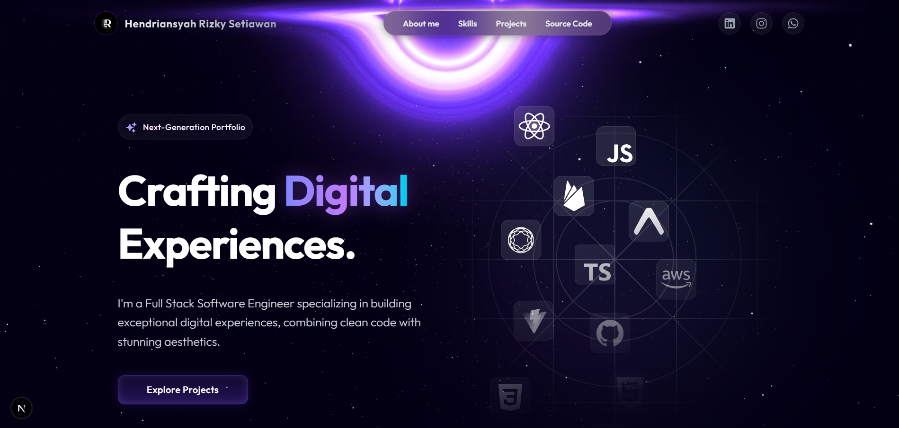

<div align="center">
  
# 🚀 Next-Gen Developer Portfolio

<p align="center">
  <strong>A breathtaking, high-performance portfolio built with the modern web stack.</strong><br>
  Featuring a fully customized admin dashboard, Google Drive CDN integration, and glassmorphism UI.
</p>

<p align="center">
  
  
  
  
  
</p>



</div>

---

## ✨ Key Features

- **📱 Stunning Modern UI**: Designed with Glassmorphism, neon gradients, and responsive layouts that look perfect on any device.
- **🎬 Butter-Smooth Animations**: Powered by Framer Motion for premium micro-interactions and page transitions.
- **🔐 Secure Admin Dashboard**: Built-in hidden route (`/nexus-hq`) protected by Firebase Auth to manage your portfolio data.
- **☁️ Google Drive CDN**: Upload project images directly to your Google Drive and serve them optimized (WebP) with preserving aspect ratios.
- **📝 Advanced Project Editor**: 
  - Rich description with Markdown & HTML support.
  - Interactive Project Type tagging (Web, Android, iOS, Windows, Linux, macOS).
  - Add up to 3 showcase view images per project.
- **⚡ Empty State UI**: Dynamic "Works in Progress" fallback state when your database is empty.

---

## 🛠 Tech Stack

- **Framework**: [Next.js 16](https://nextjs.org/) (App Router)
- **Styling**: [Tailwind CSS](https://tailwindcss.com/)
- **Animations**: [Framer Motion](https://www.framer.com/motion/)
- **Backend/DB**: [Firebase](https://firebase.google.com/) (Firestore & Authentication)
- **Icons**: [Lucide React](https://lucide.dev/) & [React Icons](https://react-icons.github.io/react-icons/)
- **Markdown Rendering**: `react-markdown`, `remark-gfm`, `rehype-raw`

---

## 🚀 Getting Started

Follow these steps to run the project locally on your machine.

### 1. Prerequisites
Make sure you have [Node.js](https://nodejs.org/) installed (v18 or higher recommended).

### 2. Clone the repository
```bash
git clone https://github.com/kyy-95631488/portofolio-hendri
cd portofolio-hendri
```

### 3. Install dependencies
```bash
npm install
# or
yarn install
```

### 4. Setup Environment Variables
Create a `.env.local` file in the root of your project and add your Firebase and Google Drive configurations:

```env
# Firebase Client Config (For Public App)
NEXT_PUBLIC_FIREBASE_API_KEY=your_api_key
NEXT_PUBLIC_FIREBASE_AUTH_DOMAIN=your_project.firebaseapp.com
NEXT_PUBLIC_FIREBASE_PROJECT_ID=your_project_id
NEXT_PUBLIC_FIREBASE_STORAGE_BUCKET=your_project.appspot.com
NEXT_PUBLIC_FIREBASE_MESSAGING_SENDER_ID=your_sender_id
NEXT_PUBLIC_FIREBASE_APP_ID=your_app_id

# Google Drive OAuth (For Admin Uploads)
NEXT_PUBLIC_GOOGLE_DRIVE_CLIENT_ID=your_google_client_id
```

### 5. Start the development server
```bash
npm run dev
```
Open [http://localhost:3000](http://localhost:3000) with your browser to see the result.

---

## 💻 Admin Setup (Nexus-HQ)

To manage your portfolio items, you need an Admin account.
1. Run the application locally.
2. If you have setup an API route for admin creation, navigate to it (e.g. `http://localhost:3000/api/create-admin`) to initialize your super-user credentials.
3. Login via `/nexus-hq` route to access your dashboard.

---

<div align="center">
  <p>Built with ❤️ by Hendriansyah Rizky Setiawan.</p>
</div>
